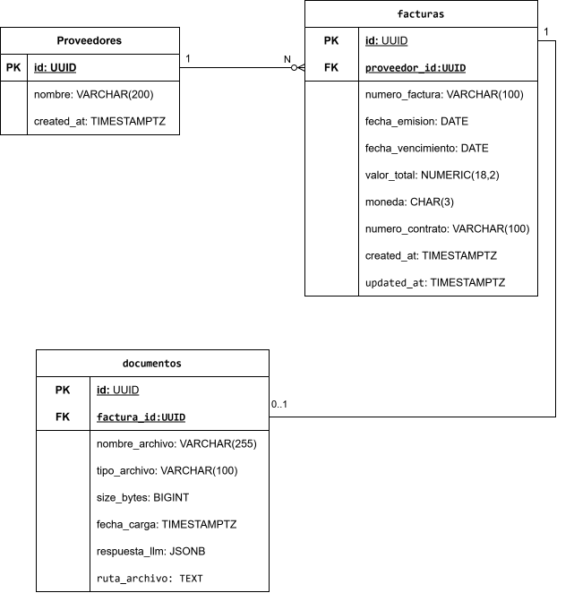

## Tecnologias

* **Frontend**: React + TS
* **Backend**: NestJs + TS
* **Base de datos**: PostgreSQL

## Como ejecutar el Proyecto

1. **Clonar el repositorio**
2. **Levantar una base de datos:** PostgreSQL con docker
3. **Iniciar el backend:** instalar las dependencias (**npm install**) y ejecutar el servidor (**npm run start:dev**)
4. **Iniciar el frontend:** instalar las dependencias (**npm install**) y ejecutar la aplicacion (**npm run dev**)

## Modelo de base de datos

Defini la estructura de la base de datos

